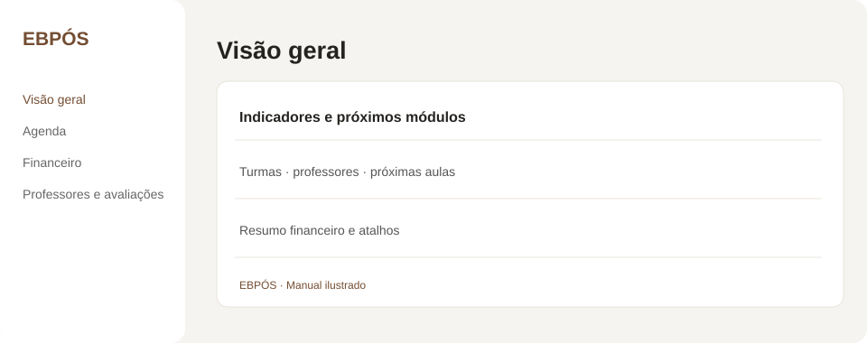
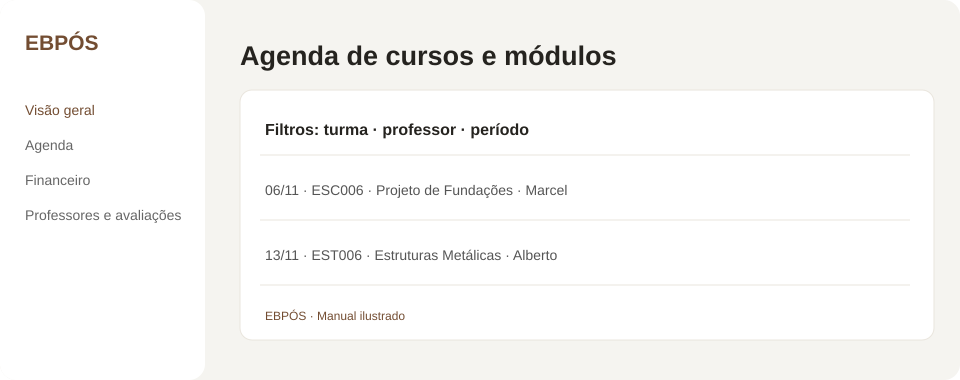
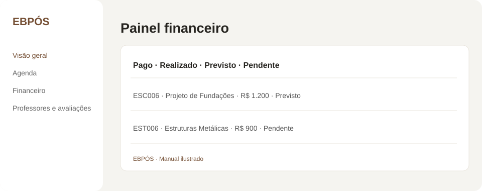
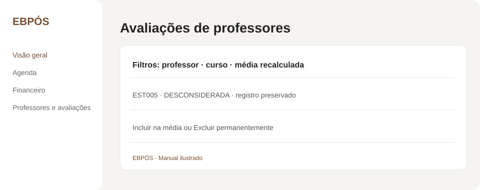

# Manual do app de Coordenação EBPÓS

Guia rápido com telas esquemáticas. Os exemplos ilustram a navegação e não exibem dados reais.

## Visão geral

Use os cartões de indicadores e as setas para navegar pelos resumos. Os atalhos levam à agenda, ao financeiro, à atualização de cadastros e às mensagens para professores.

No cartão **Desempenho dos cursos**, selecione uma turma para ver uma barra por módulo. As notas são exibidas da maior para a menor; quando há mais de uma nota para o mesmo módulo, o gráfico mostra a média.

## Agenda

Filtre por turma, professor, módulo e período. Use **Nova aula** para cadastrar e **Editar** para alterar uma sessão. A coluna de seleção permite escolher individualmente os módulos que serão enviados à agenda Google.

## Financeiro

O formulário da sessão permite escolher **Pago**, **Realizado**, **Previsto** ou **Pendente**. No painel financeiro, confira valores e datas de NF e exporte as colunas desejadas em Excel ou PDF.

## Professores e avaliações

Selecione professor e curso para filtrar. **Desconsiderar e recalcular média** mantém a avaliação no histórico, marca o cartão em vermelho e exclui sua nota da média. **Incluir na média** desfaz a ação. **Excluir** remove o registro permanentemente.

## Cadastros e dados

Nesta tela ficam os perfis de professores, turmas arquivadas, importação de arquivos e backup. Para importar, clique em **Escolher arquivo**, selecione um CSV ou JSON e depois clique em **Importar arquivo**. Para salvar uma cópia da base, use **Baixar backup JSON**.

Os dados deste app ficam no armazenamento local do navegador. Baixe backups antes de trocar de computador ou limpar os dados do navegador.
